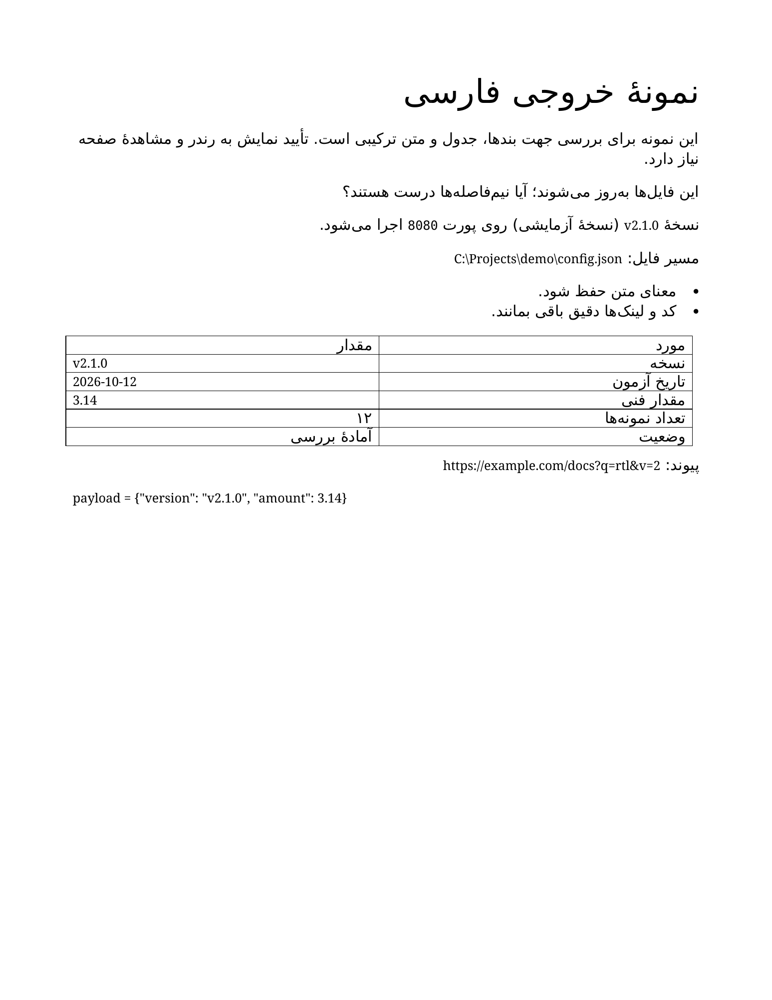

# اسکیل خروجی فارسی

**فارسی روان، جهت درست، حفظ دقیق متن فنی.**

این اسکیل برای نگارش و ویرایش فارسی و نمایش متن ترکیبی فارسی و انگلیسی در چت، وب، Word و PDF است. هستهٔ آن برای Codex و Claude Code مشترک است و به پلاگین اختصاصی وابسته نیست. ساخت فایل به ابزار مناسب همان قالب نیاز دارد.

## قابلیت‌ها

- لحن متناسب با کاربر؛ نیم‌فاصله، «ی/ک» و نشانه‌گذاری در متن تألیفی.
- راست‌به‌چپ واقعی در قالب‌های پشتیبانی‌شده و یونیکد محدود فقط هنگام نیاز.
- حفظ کد، مسیر، لینک، شناسه، تاریخ و اعداد فنی.
- بررسی مستقل ساختار و نمایش؛ اعلام روشن بخش‌های آزموده‌نشده.

این بسته مبدل خودکار متن یا موتور تولید اسناد نیست. صرف وجود یک نام فایل فارسی نباید آن را فعال کند.

## خروجی Word قبل و بعد

خروجی قبل و بعد از اصلاح سازندهٔ Word، با LibreOffice رندر شده است. در نسخهٔ اصلاح‌شده، بندهای فارسی و بولت‌ها راست‌چین هستند؛ عنوان از استایل ۲۶ پوینت استفاده می‌کند و مقادیر فنی داخل سلول‌هایی با جهت مستقل چپ‌به‌راست قرار دارند. تاریخ به‌درستی به شکل `2026-10-12` دیده می‌شود. متن معمولی ۱۲ و متن فنی ۱۰ پوینت باقی مانده‌اند.

| قبل | بعد |
| --- | --- |
|  |  |

دانلود فایل‌های واقعی Word: [قبل](examples/outputs/word-before.docx) · [بعد](examples/outputs/word-after-rtl.docx).

این تصاویر خروجی سازندهٔ Word هستند؛ مقایسهٔ عملکرد مدل با و بدون اسکیل نیستند. تاریخ و مقادیر به جدول منتقل شده‌اند تا جهت هر مقدار مستقل باشد. حفظ دقیق توکن‌های فنی و مقصد لینک بررسی شده است. بررسی تصویری مربوط به خروجی LibreOffice است؛ Microsoft Word اجرا نشده است.

## تازه در نسخهٔ 0.2.0

قابلیت‌های قبلی حفظ شده‌اند. سه مسیر اضافه شده است: ترجمهٔ انگلیسی به فارسی، ویرایش طبیعی فارسی و ترجمهٔ مقاله یا سایت در ساختار اصلی آن.

متن در بخش خودش جایگزین می‌شود؛ عکس، زیرنویس، ترتیب بخش‌ها، لینک و کد حفظ می‌شوند. جهت متن فارسی جدا از جهت چیدمان تنظیم می‌شود تا ستون‌ها و تصاویر ناخواسته جابه‌جا نشوند. این راهنما برای مقالهٔ وب، HTML، Word و PDF است؛ ابزار تبدیل خودکار همهٔ سایت‌ها و PDFها نیست.

[اصل انگلیسی نمونه](examples/layout-preservation/original.html) و [نسخهٔ فارسی نمونه](examples/layout-preservation/translated.html) تصویر و ساختار مشترک دارند. نمونهٔ درخواست:

> این مقاله را به فارسی روان ترجمه کن. عکس‌ها را در جای اصلی نگه دار، زیرنویس هر عکس را کنار همان عکس ترجمه کن، لینک و کد را تغییر نده و نسخهٔ فارسی را جدا ذخیره کن.

اگر ترجمه در فضای قبلی جا نشود، اسکیل باید مشکل را نشان دهد و دربارهٔ تغییر چیدمان سؤال کند؛ نباید متن را حذف، تصویر را بپوشاند یا نوشته را ناخوانا کوچک کند. متن داخل عکس فقط با درخواست ویرایش تصویر ترجمه می‌شود. مقالهٔ اسکن‌شده هم به OCR و بررسی آن نیاز دارد.

## نصب

پوشهٔ کامل <code dir="ltr">skills/persian-output-skill</code> را همراه فایل‌های مرجع کپی کن:

| ابزار | در پروژه | برای همهٔ پروژه‌ها |
| --- | --- | --- |
| Codex | <code dir="ltr">.agents/skills/persian-output-skill/</code> | <code dir="ltr">~/.agents/skills/persian-output-skill/</code> |
| Claude Code | <code dir="ltr">.claude/skills/persian-output-skill/</code> | <code dir="ltr">~/.claude/skills/persian-output-skill/</code> |

پوشهٔ نصب موجود را پیش از کپی بررسی کن تا شخصی‌سازی‌ها بازنویسی نشوند. ابزار را از پوشهٔ پروژه اجرا کن؛ اگر اسکیل ظاهر نشد، دوباره بازش کن. برخی نسخه‌های قدیمی Codex مسیر <code dir="ltr">~/.codex/skills</code> را دارند؛ مسیر نسخهٔ خودت را انتخاب کن و نصب تکراری نساز.

## فراخوانی

در Codex از <code dir="ltr">$persian-output-skill</code> و در Claude Code از <code dir="ltr">/persian-output-skill</code> استفاده کن. نمونهٔ درخواست:

> این گزارش را فارسی روان و راست‌به‌چپ کن؛ کد، لینک‌ها و تاریخ‌ها را تغییر نده.

## راست‌چین با راست‌به‌چپ فرق دارد

در وب، جهت با ویژگی <code dir="ltr">dir="rtl"</code> تعیین می‌شود. در Word، جهت بند و جدول باید تنظیم شود. نویسهٔ نامرئی RLM با کد <code dir="ltr">U+200F</code> فقط ممکن است به جهت متن ساده کمک کند؛ راست‌چین کردن همهٔ محیط‌ها را تضمین نمی‌کند و نباید وارد کد یا لینک شود.

## مثال و آزمون

[مثال‌های قبل و بعد](examples/before-after.md)، [نمونهٔ وب](examples/rtl-web.html)، [سناریوهای رفتاری](tests/scenarios.md) و [وضعیت اعتبارسنجی](VALIDATION.md) در بسته هستند. راهنمای انگلیسی شامل دستورهای نصب و اجرای بررسی‌هاست. برای Word و PDF، دیدن تصویر همهٔ صفحه‌ها شرط تأیید نمایش است.

مجوز بسته MIT است. اصلاحات باید با نمونهٔ مشخص و بررسی حفظ متن فنی همراه باشند.

