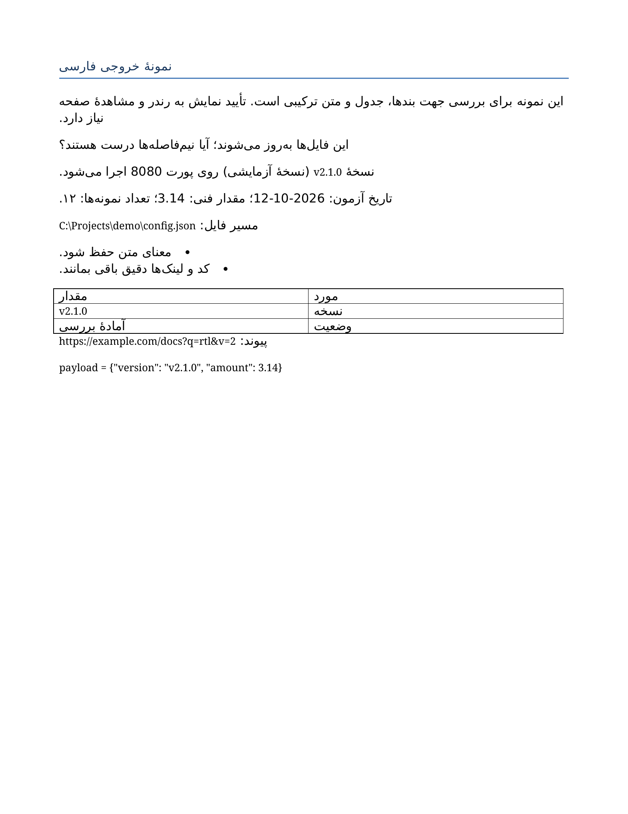
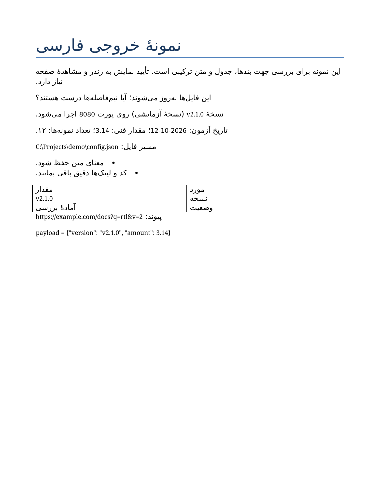

# Persian Output Skill

**Natural Persian. Correct direction. Intact technical text.**

[راهنمای فارسی](README.fa.md) · [Examples](examples/before-after.md) · [Validation](VALIDATION.md)

An instruction-first Agent Skill for Persian writing and mixed-direction output in chat, HTML, Word, and PDF. The portable core uses `SKILL.md`; Codex UI metadata is optional. No plugin, API key, runtime dependency, or font download is required to use the instructions. Artifact generation still needs tools appropriate to the requested format.

## What it does

- Adapts Persian tone and orthography to the user and audience.
- Uses native RTL metadata where supported; scopes Unicode workarounds to plain text when needed.
- Protects code, paths, URLs, identifiers, dates, and technical numbers.
- Routes to concise format-specific references and distinguishes structural from visual verification.

It is not an automatic text converter, a universal RTL renderer, or a standalone Word/PDF generator. It does not trigger just because a filename is Persian.

## Word output before and after

The same Persian fixture rendered in LibreOffice before and after the Word builder fix. The title previously had a direct 12 pt override; it now inherits the 26 pt Title style, including complex-script sizing. Body text remains 12 pt and technical runs remain 10 pt.

| Before | After |
| --- | --- |
|  |  |

Download the actual Word files: [before](examples/outputs/word-before.docx) · [after](examples/outputs/word-after.docx).

These are rendered builder outputs showing the typography fix, not an agent-with/without-skill benchmark. The source text and hyperlink target were checked for exact preservation.

## Install

Copy **the whole `skills/persian-output-skill` folder**, including references, into one destination:

| Agent | Project installation | Personal installation |
| --- | --- | --- |
| Codex | `.agents/skills/persian-output-skill/` | `~/.agents/skills/persian-output-skill/` |
| Claude Code | `.claude/skills/persian-output-skill/` | `~/.claude/skills/persian-output-skill/` |

From this repository root, PowerShell project install for Codex:

```powershell
New-Item -ItemType Directory -Force -Path .agents/skills | Out-Null
Copy-Item -LiteralPath skills/persian-output-skill -Destination .agents/skills/ -Recurse
```

For Claude Code, replace `.agents/skills` with `.claude/skills`. Run your agent from the project directory. Inspect any existing destination before copying; do not overwrite a customized skill blindly. Restart if the new skill does not appear. Some older Codex distributions use `~/.codex/skills`; use the discovery location supported by your installed version and avoid duplicate installations.

## Use

Codex:

```text
$persian-output-skill این گزارش را فارسی روان و راست‌به‌چپ کن؛ کد و لینک‌ها را تغییر نده.
```

Claude Code:

```text
/persian-output-skill این گزارش را فارسی روان و راست‌به‌چپ کن؛ کد و لینک‌ها را تغییر نده.
```

Natural-language selection is also allowed when writing quality or RTL presentation is relevant. Explicit invocation is useful when you want predictable routing.

## Try the fixtures

Open [the RTL web fixture](examples/rtl-web.html) in a browser. Read [behavioral scenarios](tests/scenarios.md), then use them in your agent. The fixtures are examples, not proof of every agent or renderer.

Run the dependency-free repository checker with Python 3.10+:

```text
python -X utf8 tools/validate.py
```

The reproducible Word example requires `python-docx`:

```text
python -X utf8 examples/build_docx.py --output sample.docx
```

Inspect a rendered result before using it as a verified deliverable. See [validation status](VALIDATION.md) for actual checks and limitations.

## Sources and compatibility

Installation instructions follow [official Codex skill documentation](https://learn.chatgpt.com/docs/build-skills) and [official Claude Code skill documentation](https://code.claude.com/docs/en/skills), reviewed 2026-10-12. Bidi guidance follows [Unicode UAX #9](https://www.unicode.org/reports/tr9/) and [W3C inline markup guidance](https://www.w3.org/International/articles/inline-bidi-markup/). Shared format support is not a claim that invocation has been tested in every client version.

Contributions should include a minimal failing example, destination/renderer, expected behavior, and checks that protected text remains intact. Do not submit private documents or credentials. MIT licensed; see [LICENSE](LICENSE).
